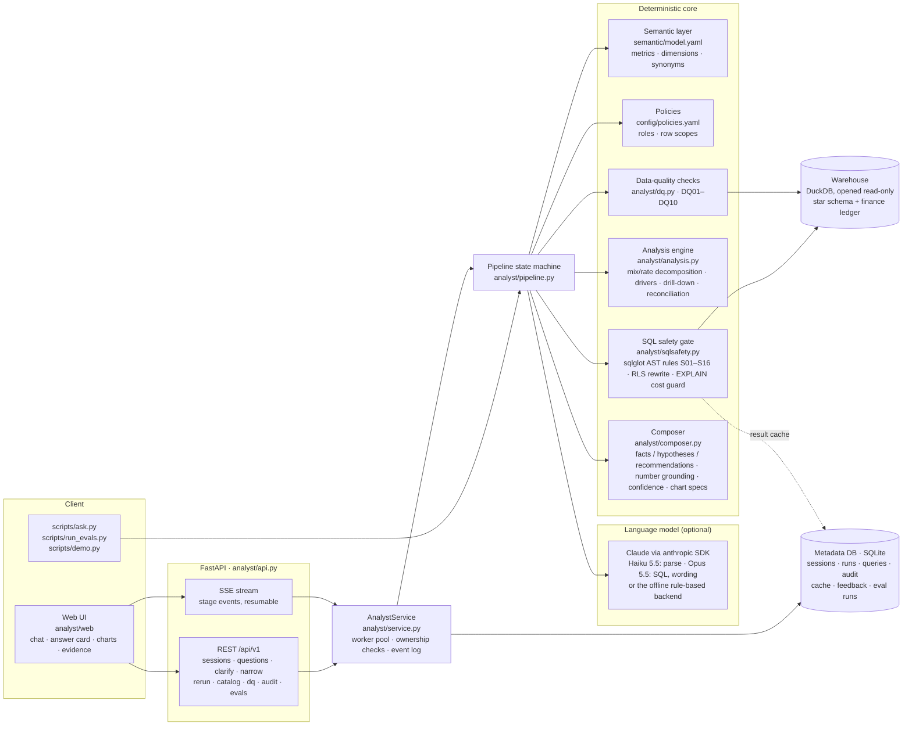
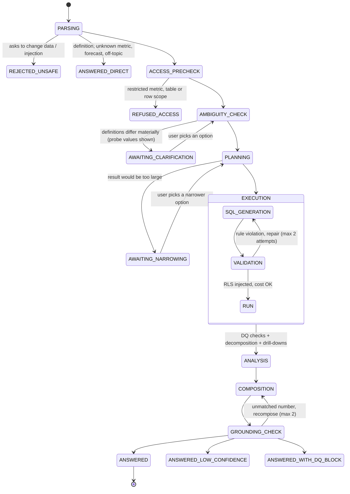
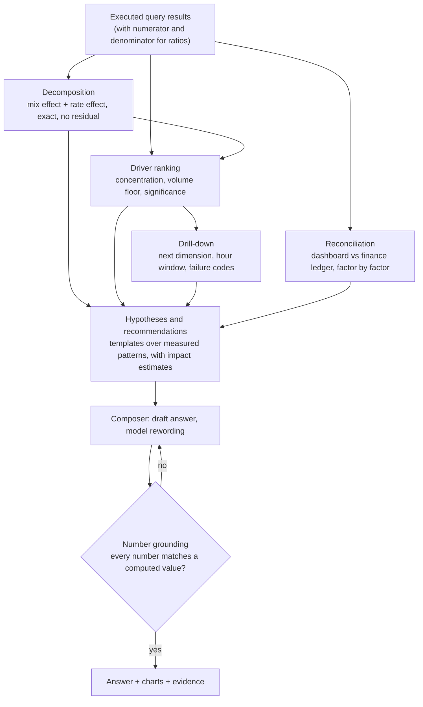

# Architecture

The design rule throughout: **the language model proposes, deterministic code decides.** The model reads the question, writes SQL and words the answer. Code decides what may run (policies, SQL validation, row-level security, cost limits), computes every number (decomposition, driver ranking, reconciliation), and checks that every number in the answer traces back to a query result.

## Components

## The question lifecycle

Every question runs through one state machine ([`analyst/pipeline.py`](../analyst/pipeline.py)). Each stage appends to a trace, and the trace is streamed to the UI as it happens.

## Defence in depth for data access

A request reaches the warehouse only after passing every layer. Each layer would hold even if the one before it were bypassed.

| Layer | Where | What it stops |
|---|---|---|
| 1. Intent pre-check | `policies.py` (`Policy.authorize`) | A restricted metric, table or row scope, refused before any SQL exists, with alternatives the role can use |
| 2. Planner uses the semantic layer only | `planner.py`, `semantic.py` | Queries compiled from governed metric definitions, not free-form SQL, where possible |
| 3. SQL validator (sqlglot AST) | `sqlsafety.py` S01–S16 | Statements other than SELECT, several statements, file and extension access, system tables, tables or columns the role cannot use, row-level output for aggregate-only roles, missing time filters, oversized results |
| 4. Row-level security rewrite | `sqlsafety.py` | Every table reference, including inside subqueries and CTEs, is wrapped with the role's row predicate (e.g. `region = 'WEST'`); the SQL that ran is shown in the evidence |
| 5. Cost guard | `EXPLAIN` before execution | Scans above the configured row estimate go to narrowing instead |
| 6. Sealed executor | `executor.py` | DuckDB opened read-only with configuration locked; refuses any query not sealed by the validator; timeout and row cap |
| 7. Audit | `store.py` `access_audit` | Every execution, refusal and rejected request is logged with user, role and predicates |

## Where the numbers come from

The model may reword the draft, but it cannot introduce a number: the grounding check compares every figure in the headline, facts and recommendations with the values the analysis computed, allowing for display rounding. A rewrite that fails the check is discarded, and the deterministic draft is used instead.

## Data model

Payments star schema in DuckDB ([`analyst/datagen.py`](../analyst/datagen.py)):
- **Facts:** `fact_payment_attempts_raw` (about 1M attempts, with planted duplicates), deduplicated through the view `v_attempts`; orders through the view `v_orders`; `fact_settlements`; and `fact_refunds`.
- **Dimensions:** `dim_merchant` (SCD2: one surrogate key per version, so joins are point-in-time), `dim_payment_method`, `dim_issuer_bank`, `dim_acquirer`, `dim_failure_reason` and `dim_date`.
- **Finance source:** `finance_daily_settlement_summary`, an independent ledger that disagrees with the dashboard on purpose (timezone day boundaries, reversed, failed and held settlements, missing merchants).

`_data_versions` stamps every table. The version goes into every answer, every query record and the cache key.
